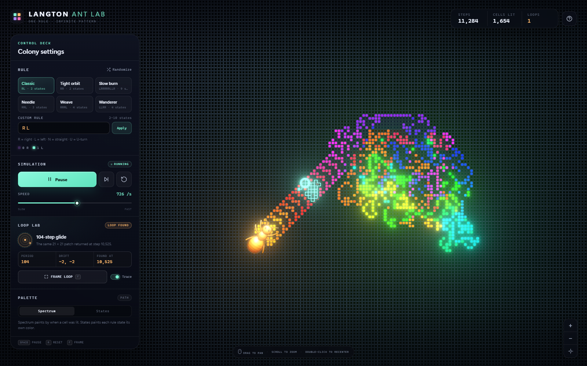

# Langton Ant Lab

A neon, interactive **Langton's ant** playground built with **Three.js** and **Vite**.
Watch a tiny two-rule automaton grow a colorful colony, detect the moment its local
pattern starts repeating, and frame the loop that emerges.



## Features

- **451 × 451 finite grid** with a custom shader grid, bloom, and a hand-drawn SVG ant.
- **Colorful path tiles** in two palettes: a time-and-space spectrum, or one fixed
  color per rule state.
- **Generalized rules** with `R`, `L`, `N`, and `U` turns, plus six presets and a
  random-rule button.
- **Loop Lab** that fingerprints the 21 × 21 neighborhood around the ant, reports the
  period and drift of a recurrence, and draws the cycle.
- **Shareable states** through URL parameters.
- **Responsive UI** with keyboard shortcuts, touch-friendly controls, and auto-follow.

## Quick start

### Requirements

- **Node.js 20.19+ or 22.12+** (includes npm)
- A modern browser with **WebGL 2** enabled
- **Git** (only if you are cloning the repository)

No API keys, environment variables, backend, or database are required.

### 1. Clone the repository

```bash
git clone https://github.com/dmoreira-git/langton-ant-js.git
cd langton-ant-js
```

### 2. Install dependencies

```bash
npm install
```

### 3. Start the development server

```bash
npm run dev
```

Open **http://localhost:5173/** in your browser. The server prints the exact URL when
it starts. Leave the terminal open while you use the app.

### Using pnpm instead

```bash
pnpm install
pnpm dev
```

The repository includes a `pnpm-workspace.yaml` that selects pnpm's flat `hoisted`
linker. npm users do not need this file and can ignore it.

### Windows shortcut

If you are on Windows and have already run `npm install`, you can start the server
by double-clicking **`run.cmd`** or running:

```powershell
.\run.cmd
```

This file is an optional convenience; `npm install` and `npm run dev` work on every
platform.

## Controls

| Input | Action |
| --- | --- |
| `Space` | Play / pause |
| `→` | Advance one step |
| `R` | Reset the colony |
| `F` | Frame the detected loop |
| Drag | Pan the camera (turns off auto-follow) |
| Scroll | Zoom at the cursor |
| Double-click | Recenter and resume auto-follow |
| `+` / `−` / home button | Camera controls |

Auto-follow keeps the growing colony framed while it runs. Panning or zooming hands
the camera to you; the home button or a double-click gives it back.

## How Langton's ant works

Each character in a rule is the turn the ant takes when it lands on that cell state:

| Symbol | Turn |
| --- | --- |
| `R` | Right |
| `L` | Left |
| `N` | Straight |
| `U` | U-turn |

On every tick the ant:

1. Reads the state of the cell beneath it.
2. Looks up the corresponding turn in the rule.
3. Advances that cell to its next state.
4. Moves one cell forward.

For the classic `RL` rule, state `0` turns right and flips to `1`; state `1` turns
left and flips to `0`. There is no randomness.

The grid is finite, so the ant stops when it reaches an edge. Reset to start a new
walk, or zoom out to watch the edge approach.

## The Loop Lab

After roughly 10,000 steps, the classic rule stops wandering and begins building a
**104-step highway** that translates across the grid indefinitely. The Loop Lab finds
recurrences like this automatically.

It fingerprints a **21 × 21 patch** around the ant. When an identical patch returns,
it records:

- **Period** — the number of steps between recurrences.
- **Drift** — how far the pattern moved per cycle, in cells (`Δx, Δy`).
- **Found at** — the step at which the recurrence was detected.

The mint trace draws one complete period. A **ring** marks the start and a **diamond**
marks the end, making the drift visible. Select **Frame loop** (or press `F`) to zoom
to the trace.

### Preset outcomes

Exact detection steps depend on the rule, but the loops are stable:

| Preset | Rule | Period | Drift | Typically found |
| --- | --- | ---: | --- | ---: |
| Classic | `RL` | 104 | `-2, -2` | ~10,525 |
| Tight orbit | `RR` | 8 | `0, 0` | ~248 |
| Needle | `RRL` | 18 | `+1, -1` | ~258 |
| Weave | `RRRL` | 52 | `+2, -2` | ~344 |
| Slow burn | `LRRRRRLLR` | 374 | `+1, -1` | ~28,827 |
| Wanderer | `LLRR` | — | — | no early loop |

Different rules produce boxes, glides, long slow recurrences, or no local recurrence
at all. Randomize the rule and the detector keeps listening.

## Shareable states

With the dev server running, add these query parameters to the page URL:

```text
?steps=11200                  jump ahead to step 11,200
?rule=RR&steps=400            load a rule and jump ahead
?rule=RL&steps=10525&frame=1  jump to the highway and frame its loop
?panel=1                      open the controls sheet on a narrow screen
```

The parameters are read on page load, so they are useful for demos, screenshots, and
bug reports.

## Project structure

| Path | Purpose |
| --- | --- |
| [`src/langton.js`](src/langton.js) | Ant state machine, generalized rules, local-patch cycle detector |
| [`src/main.js`](src/main.js) | Three.js scene, instanced tiles, camera, loop trace, UI wiring |
| [`src/style.css`](src/style.css) | Dark glass UI and responsive layout |
| [`public/ant.svg`](public/ant.svg) | The ant sprite |
| [`index.html`](index.html) | Page shell and control markup |
| [`vite.config.js`](vite.config.js) | Dev server and build configuration |

The ant artwork is a standalone SVG. Replace `public/ant.svg` with any transparent
portrait-oriented image (head pointing up) to change the sprite.

## Available scripts

| Command | Description |
| --- | --- |
| `npm run dev` | Start the Vite dev server |
| `npm run build` | Create a production build in `dist/` |
| `npm run preview` | Serve the production build locally |
| `npm run dev -- --port 5174` | Start on a different port if 5173 is taken |

The same commands work with pnpm (`pnpm dev`, `pnpm build`, and so on).

## How it is built

- **Three.js** renders the tiles as a single `InstancedMesh` with one instanced draw
  call. Tile colors update incrementally through `BufferAttribute` update ranges.
- **Vite** provides the dev server and production build.
- The grid, ambient glow, and vignette are shader effects; bloom is a post-processing
  pass. There are no per-cell DOM elements.
- The loop detector stores a 64-bit fingerprint of the local patch and stops once a
  recurrence is found.

For quick console experiments, the simulation is exposed as `window.antLab`:

```js
antLab.sim.steps;
antLab.applyRule('RRL');
antLab.frameLoop();
antLab.setPlaying(false);
```

## Troubleshooting

**The page is blank or WebGL fails to start.**  
Enable hardware acceleration in your browser and make sure it supports WebGL 2. Try a
current version of Chrome, Edge, Firefox, or Safari.

**Port 5173 is already in use.**  
Run `npm run dev -- --port 5174` and open the URL printed by Vite.

**`run.cmd` is blocked by PowerShell.**  
Use `npm run dev` instead. If you want to use the script, run it with a one-time
process policy:

```powershell
powershell -NoProfile -ExecutionPolicy Bypass -File .\run.ps1
```

**Dependencies are missing when starting the Windows shortcut.**  
Run `npm install` first, then start `run.cmd` again.

**pnpm reports symlink or junction errors on Windows.**  
Use `npm install` instead. The included `pnpm-workspace.yaml` also selects pnpm's
flat linker, which avoids the usual junction issues.

## Credits

Langton's ant was devised by **Chris Langton** in 1986. The classic highway behavior
was popularized by later computer experiments. This implementation and visualization
were built as a hands-on Three.js sample project.
